<div align="center">

# 🚨 SafeCity AI
### **Autonomous 3D Underground Disaster Response & Accessible Evacuation Twin**
**Powered by Google DeepMind `Gemini 4 Argon` · WebGL/Three.js Real-Time Spatial Simulation**

[](https://ai.google.dev/)
[](https://ai.google.dev/)
[](https://nextjs.org/)
[](https://threejs.org/)
[](https://cloud.google.com/run)

> **"When 110mm/hr flash floods submerge an underground metro station, stairs become waterfalls in 180 seconds. For a wheelchair user on Basement Level 3, a generic exit sign is not an evacuation plan—it is a trap. SafeCity AI turns Gemini 4 Argon into a real-time 3D life-saving command center."**
>
> **"시간당 110mm의 극한 호우가 지하철역을 덮칠 때, 일반 계단은 3분 만에 폭포로 변합니다. 지하 3층에 고립된 휠체어 이용자에게 '계단 비상구' 표지판은 탈출구가 아닙니다. SafeCity AI는 Gemini 4 Argon의 추론 능력과 실시간 3D 디지털 트윈을 결합해, 골든타임 6분 내 교통약자를 포함한 120명 전원을 구출하는 차세대 재난 관제 시스템입니다."**

</div>

---

## 🌍 1. Why SafeCity AI Matters (Problem & Social Impact)

### The Silent Crisis in Underground Megacities
High-density underground transit hubs (such as **Yeouido Station B2–B3 Transfer Complex** in Seoul) serve hundreds of thousands of commuters daily. During extreme climate events—flash floods, subterranean fires, or power grid failures—two fatal bottlenecks occur within the **6-minute Golden Time**:

1. **Zero Visibility & Dynamic Hazard Propagation:** Rising floodwaters (`0.0m → 5.0m`) rapidly invalidate static 2D wall maps. An exit route that was safe 90 seconds ago may now be an electrocution or drowning hazard.
2. **Evacuation Inequality for Vulnerable Citizens (교통약자 대피 단절):** Wheelchair users, the elderly, and visually impaired passengers cannot climb flooded stairwells. They require **real-time, barrier-free 3D routing** to operational waterproof elevators (`방수형 특별피난 승강기`) and pressurized refuge zones.

### Our Breakthrough: Fusion of Track 3 (Social Good) × Track 1 (3D Simulation)
**SafeCity AI** goes far beyond a text-based emergency chatbot. It fuses **Track 3 (*Google AI for Social Good: Local Emergency Preparedness & Verifiable Field Checklists*)** with **real-time 3D WebGL Digital Twin simulation**:
- **Multimodal Context Synthesis:** Synthesizes municipal flood hazard telemetry, live KMA weather feeds (`110mm/h`), Google Maps grounding, and station structural blueprints (B2–B3 CAD/PDF) in a single **Gemini 4 Argon** reasoning pass.
- **Dual-Path 3D Holographic Routing:** Computes and renders both **Standard Evacuation Tubes (`Neon Green`)** and **Wheelchair/Accessible Waterproof Elevator Bypass Tubes (`Flashing Neon Yellow`)** directly in 3D space.
- **Autonomous Interceptor Drone Dispatch:** Directs an indoor rescue quadcopter (`DRONE-A1`) with a real-time vertical searchlight (`SpotLight`) to illuminate submerged hazard zones and guide isolated passengers.

---

## 🧠 2. System Architecture & Argon Reasoning Loop

```mermaid
flowchart LR
    subgraph Input["🎙️ Multimodal Field Input"]
        V["Web Speech API\n(Real-Time Voice Command)"]
        P["Tactical Hazard Presets\n(B2 Flood / B3 Wheelchair / Pump)"]
        S["Hydro-Sonar Telemetry\n(Water Level 0.0m ~ 5.0m)"]
    end

    subgraph Core["⚡ Gemini 4 Argon Engine (/api/simulate)"]
        G["1M Context Grounding\n• Station Blueprint PDF\n• KMA Weather & Maps"]
        R["Spatial Hazard Reasoning\n• Stairwell Inundation Calc\n• Barrier-Free Graph Search"]
        F["Resilient Edge Fallback\n• Zero-Downtime Safety Net"]
    end

    subgraph Twin["🌐 Real-Time 3D Digital Twin & Command UI"]
        W["3D Fluid & Foam Physics\n(MeshPhysicalMaterial + Caustics)"]
        T["Dynamic 3D Neon Tubes\n(Green Standard / Yellow Accessible)"]
        D["Autonomous Rescue Drone\n(Volumetric SpotLight + Strobe)"]
        C["Verifiable Field Checklist\n& Typewriter Reasoning Terminal"]
    end

    Input --> Core
    G --> R --> F --> Twin
```



---

## ✨ 3. Key Technical Innovations

### 🎬 A. Hollywood-Grade 3D Disaster Graphics ([`components/ThreeViewer.tsx`](components/ThreeViewer.tsx))
- **Atmospheric Underground Environment:** Powered by `THREE.FogExp2('#020617', 0.02)`, procedural dark metallic rivet tile textures (`CanvasTexture`), overhead truss fluorescent strips, and flickering emergency beacons.
- **Real-Time Fluid & Pillar Foam Physics (`RisingWaterAndFoam`):**
  - Physically based water surface (`MeshPhysicalMaterial` with `transmission: 0.6`, `roughness: 0.1`, `metalness: 0.1`, `ior: 1.333`, `clearcoat: 1.0`) combined with animated water caustics and `useFrame` multi-sine vertex wave displacement.
  - **Wet Concrete Specular Shader:** Structural pillars dynamically darken and increase specular reflectivity (`clearcoat: 1.0`, `roughness: 0.05`) proportional to the rising water line, surrounded by churning white foam rings and particle emitters (`Points`).
- **High-Velocity Holographic Evacuation Tubes (`DynamicEvacuationPath`):**
  - Dual-layer `THREE.TubeGeometry` mapped with a procedural neon chevron (`>>>`) `CanvasTexture` whose `texture.offset.x` scrolls at high speed in `useFrame`, accompanied by an additive-blended outer glow halo.
- **Autonomous Searchlight Drone (`AutonomousRescueDrone`):**
  - Features alternating Red/Blue emergency strobe LEDs, 4 high-RPM rotors, swirling light-shard dust particles, and a downward conical `SpotLight` (`angle: 0.4`, `penumbra: 0.8`, `color: '#ffffff'`) with a surface target projection ring that sweeps the dark floodwaters.
- **Cinematic Orbit Camera Rig (`CinematicCameraRig`):**
  - Automatically performs a smooth cubic ease-out aerial sweep across the underground station whenever a new disaster scenario is triggered.

### 🖥️ B. Cybernetic Situation Room UI ([`components/DashboardPanel.tsx`](components/DashboardPanel.tsx) & [`components/VoiceController.tsx`](components/VoiceController.tsx))
- **Live Audio & Hydro-Sonar Waveforms:** Real-time HTML5 Canvas audio frequency visualizer next to the Web Speech API microphone and a live oscillating hydro-sonar sparkline graph tracking water rise rate (`+m/min`).
- **Verifiable Field Checklist (현장 대원 검증 루프):** Interactive field response checklist for floodgate closure, waterproof elevator priority lock, and drone life-tube deployment.
- **Argon Reasoning Loop Terminal:** Real-time character-by-character typewriter log console streaming `[SENSE]`, `[ARGON-CORE]`, `[PATHFINDER]`, and `[DRONE-OPS]` telemetry.
- **Frameless CCTV Monitor Aesthetics:** Full-screen peripheral vignette (`cctv-vignette`) and subtle CRT scanline overlay (`cctv-scanlines`).

---

## 🏆 4. Alignment with Official Hackathon Evaluation Criteria

| Evaluation Criterion | How SafeCity AI Delivers Excellence |
| :--- | :--- |
| **1. Working Live Demo** | **100% Zero-Crash Execution:** Live Web Speech API voice commands, 3 instant chain-reaction presets, and an interactive flood-surge slider dynamically drive the Gemini 4 Argon backend (`/api/simulate`) and 60fps Three.js scene. Includes automatic multi-model fallback (`gemini-4-argon` → `gemini-2.0-flash` → `gemini-1.5-pro` → Edge Resilient Simulation). |
| **2. Problem & Impact** | **Saving the Most Vulnerable First:** Solves the life-or-death accessibility gap in underground disasters by computing barrier-free waterproof elevator bypass routes (`vulnerablePath`) alongside standard exits (`evacuationPath`), targeting **100% safe evacuation of 120 citizens within the 6-minute Golden Time**. |
| **3. Originality & Creativity** | **Beyond Chatbots → Agentic 3D Spatial Control:** Transforms LLM reasoning directly into 3D spatial coordinates (`dangerZone`, `evacuationPath`, `vulnerablePath`, `droneTarget`), fluid levels, and autonomous drone spotlight vectors in a single closed-loop interface. |
| **4. Clarity of Description** | **Instant Visual & Tactical Comprehension:** Color-coded 3D holograms (Green = Standard, Yellow = Wheelchair/Elevator, Red = Hazard, White Beam = Rescue Drone) paired with a structured diagnostic report card and verifiable field checklist. |

---

## 📡 5. AI Spatial Simulation API Schema ([`app/api/simulate/route.ts`](app/api/simulate/route.ts))

### `POST /api/simulate`
**Request Body:**
```json
{
  "prompt": "지하 3층 승강장 휠체어 이용자 고립 발생, 방수 엘리베이터 경유 교통약자 우회로 탐색",
  "currentLevel": 2.3
}
```

**Response JSON Schema:**
```json
{
  "status": "DANGER",
  "scenario": "지하 3층 승강장 교통약자(휠체어) 고립 및 방수 엘리베이터 우회 작전",
  "waterLevel": 2.3,
  "dangerZone": [-6, 1.2, -9],
  "evacuationPath": [[-4, 0.8, -8], [-8, 1.0, -2], [-12, 1.2, 5], [-15, 3.6, 11]],
  "vulnerablePath": [[-5, 0.8, -9], [2, 0.9, -6], [9, 1.0, -3], [13, 1.1, -2], [13, 4.6, -2], [16, 4.6, 9]],
  "droneTarget": [-5, 3.2, -9],
  "aiReport": {
    "summary": "승강장 서측 계단실 침수(수위 2.3m)로 일반 경사로 진입 불가. 동측 방수형 특별피난 엘리베이터(호기 #3) 수직 샤프트 정상 가동 확인.",
    "casualties": "휠체어 이용자 2명 및 동반 승객 14명 고립 위험 | 잔여 골든타임 06분 40초",
    "actionRequired": "동측 차수 격벽 2단계 폐쇄 후 네온 옐로우(교통약자 전용) 유도등 점등, 구조 드론 #1을 [-5, 3.2, -9] 상공에 배치해 음성 안내 및 구명 튜브 투하 준비."
  }
}
```

---

## 🚀 6. Quick Start & Cloud Run Deployment

### Local Development
```bash
# 1. Install dependencies
npm install --legacy-peer-deps

# 2. (Optional) Configure Gemini API Key
# Even without an API key, SafeCity AI's Resilient Edge Engine runs all 3D scenarios seamlessly!
echo "GEMINI_API_KEY=your_api_key_here" > .env.local

# 3. Launch development server
npm run dev
```
Open **`http://localhost:3000`** in Chrome/Edge (for Web Speech API voice recognition support).

### Production Build & Google Cloud Run Deployment
SafeCity AI is configured with `output: 'standalone'` in [`next.config.mjs`](next.config.mjs) and includes a multi-stage Node 20 Alpine [`Dockerfile`](Dockerfile) optimized for **Google Cloud Run (`PORT=8080`)**:

```bash
# Build and run with Docker locally
docker build -t safecity-ai .
docker run -p 8080:8080 -e GEMINI_API_KEY=your_api_key_here safecity-ai

# One-command deploy to Google Cloud Run
gcloud run deploy safecity-ai \
  --source . \
  --region asia-northeast3 \
  --allow-unauthenticated \
  --set-env-vars="GEMINI_API_KEY=your_api_key_here"
```

---

## 📂 7. Project Structure

```text
SafeCity-AI/
├── app/
│   ├── api/simulate/route.ts   # Gemini 4 Argon Spatial Reasoning API + Resilient Fallback
│   ├── globals.css             # Cybernetic HUD, CCTV Vignette, Scanlines & Hazard Stripes
│   ├── layout.tsx              # Next.js 14 Root Layout (Dark Mode Command Center)
│   └── page.tsx                # 70:30 Split Screen Digital Twin Monitor & Chain-Reaction State
├── components/
│   ├── ThreeViewer.tsx         # WebGL/Three.js B2-B3 Station, Fluid/Foam, Flowing Tubes & Drone
│   ├── VoiceController.tsx     # Web Speech API + Live Audio Waveform + 3 Tactical Presets
│   └── DashboardPanel.tsx      # Hydro-Sonar Sparkline, Argon Report, Checklist & Typewriter Logs
├── types/
│   └── simulation.ts           # Strict TypeScript Interfaces for 3D Vectors & Telemetry
├── Dockerfile                  # Multi-stage Node 20 Alpine Image for Google Cloud Run
├── next.config.mjs             # Standalone Output & Three.js Transpilation Config
└── tailwind.config.ts          # Cybernetic Color Palette & Scanline Keyframe Animations
```

---

<div align="center">
  <b>Built with ❤️ for Google DeepMind AI Hackathon — Track 3: Google AI for Social Good</b><br/>
  <i>"Technology finds its highest purpose when it protects those most at risk."</i>
</div>
